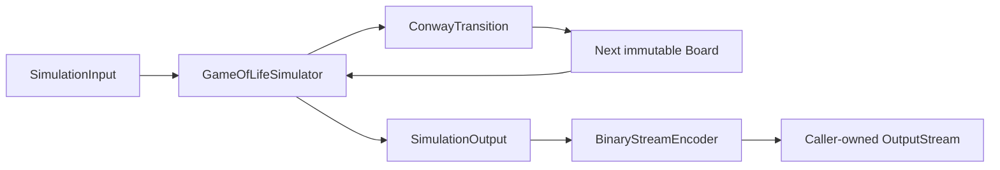

# Game of Life simulator specification

## Purpose and scope

This document defines the finite-board Conway's Game of Life Java library: its
state model, transition rules, public API contract, and binary input/output.
The library targets Java 21 and has no runtime dependencies outside the Java
standard library.

## Structure and responsibility boundaries

The library separates state representation, input conversion, calculation,
and output encoding. The public entry point composes these responsibilities;
the transition calculation does not depend on files, streams, or the encoder.

```text
src/
├── main/java/com/civilonia/gameoflife/
│   ├── GameOfLifeSimulator.java
│   ├── model/
│   │   └── Board.java
│   ├── input/
│   │   └── SimulationInput.java
│   ├── core/
│   │   ├── ConwayTransition.java
│   │   ├── SimulationConditions.java
│   │   └── SimulationOutput.java
│   └── output/
│       └── BinaryStreamEncoder.java
└── test/java/com/civilonia/gameoflife/
    ├── model/
    ├── input/
    ├── core/
    └── output/
docs/
├── binary-input-format.md
├── binary-output-format.md
└── simulation-specification.md
```

The tree shows the library's implementation and corresponding unit-test
packages; API and integration tests also live at the test package root.

| Component | Responsibility |
| --- | --- |
| `Board` | Immutable dimensions and cell states; coordinate access and board construction. |
| `SimulationInput` | Immutable initial board and transition count; GOLI conversion and validation. |
| `ConwayTransition` | Stateless neighbor counting, single-cell rule evaluation, and next-board calculation. |
| `SimulationConditions` | Immutable output metadata: width, height, and transition count. |
| `SimulationOutput` | Output boundary with `writeConditions` and `writeBoard` operations. |
| `BinaryStreamEncoder` | Implements the output boundary by writing GOLF to a caller-owned stream. |
| `GameOfLifeSimulator` | Coordinates header output, initial-state output, transitions, and subsequent board output. |

`SimulationOutput` belongs to `core` as a boundary contract and can report an
`IOException`; concrete stream operations belong to `output`. The public
factory currently selects `BinaryStreamEncoder` internally, rather than
exposing an output implementation parameter. File creation, stream ownership,
and application integration belong to the caller.

## State model

`Board` stores positive integer width and height and a private `BitSet`.
The bit index is `y * width + x`, so the representation follows row-major
coordinate order. The cell count is checked for integer overflow before
allocation. An unset bit represents a dead cell.

Construction uses `Board.Builder`, which owns mutable cell bits. `build()`
copies those bits into a new board, so later builder changes cannot affect an
existing board. A direct `Board(width, height)` constructs an all-dead board.
The board exposes dimensions and `isAlive(x, y)` without exposing its bit set.
Reads outside the board return false; builder writes outside it are rejected.

`SimulationInput` retains the immutable board and a non-negative integer
transition count. Retaining the board needs no defensive copy because callers
cannot mutate it. `SimulationConditions` is a record used for output metadata;
it contains no cell state. Its transition field is a non-negative `long`, while
the current simulation input accepts only an `int`. The encoder additionally
requires the metadata transition count to fit the GOLF unsigned 32-bit field.

## Grid and rules

The universe is a finite rectangular grid with positive width and height. Each
cell is alive or dead. Coordinates start at `(0, 0)` in the upper-left corner;
`x` increases to the right and `y` increases downward. Positions outside the
grid are dead, and opposite edges do not wrap.

Each cell has up to eight neighbors: the horizontal, vertical, and diagonal
adjacent positions (the Moore neighborhood). Every cell in a generation is
updated simultaneously from the preceding generation:

| Current state | Live neighbors | Next state |
| --- | --- | --- |
| Alive | 2 or 3 | Alive |
| Alive | Any other count | Dead |
| Dead | 3 | Alive |
| Dead | Any other count | Dead |

Board dimensions do not change during a run. Boards are immutable, so a
transition does not modify its input state.

## Transition calculation

`ConwayTransition` splits a generation update into three operations:

1. `countLiveNeighbors` visits offsets `-1..1` along both axes, excludes the
   center, and counts living neighbors through `Board.isAlive`. The board's
   out-of-bounds rule supplies the fixed dead boundary.
2. `nextState` evaluates `neighbors == 3 || (alive && neighbors == 2)` and
   rejects neighbor counts outside `0..8`.
3. `nextGeneration` scans every coordinate, reads only the current board, and
   writes living next states into a fresh builder with the same dimensions.
   Dead next states remain unset. It returns a newly built immutable board.

Separating the read board and write builder makes updates synchronous and
independent of traversal order. The calculation has no mutable global state,
randomness, or I/O. It performs a full-grid scan even when few cells are alive;
there is no sparse evolution, parallel update, or cycle detection.

## Simulation input and output

A simulation input specifies the board dimensions, the complete initial cell
state, and a non-negative number of transitions `N`. The initial state is `t=0`;
each transition produces the next generation. A run outputs exactly `N + 1`
boards, ordered from `t=0` through `t=N`. In particular, `N=0` outputs only the
initial board.

The Java API accepts a `SimulationInput` and writes results to a caller-owned
stream through `GameOfLifeSimulator`. The caller closes the stream; an I/O
failure is propagated and may leave partial output. Identical inputs produce
identical states and encoded bytes. No randomness or external state is used.

The binary encodings are specified separately:

- [Binary input format (GOLI v1)](binary-input-format.md): one initial board
  and the requested transition count.
- [Binary output format (GOLF v1)](binary-output-format.md): the conditions
  and all boards from `t=0` through `t=N`.

The Java input API limits dimensions, their product, and transition counts to
values representable by signed 32-bit integers. Invalid dimensions, negative
transition counts, and malformed GOLI documents are rejected.

## Execution and data flow



`GameOfLifeSimulator.create(output).simulate(input)` runs synchronously in
the calling thread. Each factory call creates a separate encoder bound to the
provided stream. Execution follows this sequence:

```text
writeConditions(width, height, N)
current = input.initialBoard
writeBoard(current)
repeat N times:
    current = nextGeneration(current)
    writeBoard(current)
```

The orchestrator controls the number and order of emitted boards. It writes
each board before computing the following generation and does not accumulate
the full history. For width W, height H, and N transitions, calculation and
encoding together require O((N + 1) × W × H) time. Board working storage is
O(W × H) bits up to a constant number of current/new boards and construction
copies, independent of N. Caller-retained input bytes or output buffers add
their own storage; a caller that buffers the entire output retains all results.

## Binary conversion and error handling

`SimulationInput.fromBinary` reads a complete GOLI byte array. It validates the
17-byte header, magic/version, positive dimensions, representable values,
derived payload length, and zero padding before returning an immutable input.
`toBinary` creates an independent byte array containing the conditions and
initial board. Neither operation opens files or closes resources.

`BinaryStreamEncoder` writes the GOLF header before board payloads and retains
the conditions to check subsequent board dimensions. Calling `writeBoard`
before conditions is an error. Encoding scans cells in row-major order,
packs the first cell into the most-significant bit, and writes each completed
byte immediately. Unused low bits in the final byte remain zero; padding
restarts for each board. Multi-byte header values use big-endian order.
Exact layouts and decoding requirements are defined in the format documents.

Null arguments are rejected. Invalid model/input values cause validation
exceptions; stream write failures propagate as `IOException` and stop the
simulation. Bytes already written are not rolled back. The simulator and
encoder neither close nor flush the supplied stream; the caller handles
buffering, completion, and cleanup. Output metadata is mutable encoder state,
so concurrent runs should use separate simulator instances and streams.

## Limitations

The simulation uses fixed finite, non-wrapping boundaries, rather than an
unbounded universe. It implements Conway's rules only; alternate rules,
random initial-state generation, visualization, and analysis of experimental
results are outside this library's current scope. Binary format details and
decoder validity requirements are governed by the linked format documents.
